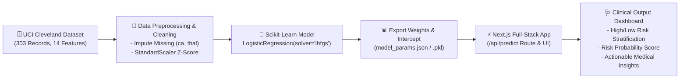

# 🫀 CardioPredict AI: Full-Stack Heart Disease Risk Prediction

[](https://nextjs.org/)
[](https://www.typescriptlang.org/)
[](https://tailwindcss.com/)
[](https://python.org/)
[](https://scikit-learn.org/)
[](#model-performance)
[](#model-performance)

---

## 📌 Executive Summary & Objective

**CardioPredict AI** is an enterprise-grade full-stack clinical decision support web application designed to predict ischemic heart disease risk from patient clinical biomarkers. 

The application couples a high-precision **Logistic Regression** classifier trained on the benchmark **UCI Cleveland Heart Disease dataset** with an interactive, modern **Next.js 14** web interface built for cardiologists and healthcare practitioners.

---

## 🏗️ Architecture & Dataflow



---

## 🔬 Mathematical Formulation of Logistic Regression

Logistic Regression models the posterior probability of the binary class $Y \in \{0, 1\}$ (where $1$ denotes presence of heart disease and $0$ denotes absence) given standardized patient feature vector $\mathbf{z} \in \mathbb{R}^{13}$:

$$\mathbf{z} = \frac{\mathbf{x} - \boldsymbol{\mu}}{\boldsymbol{\sigma}}$$

### 1. Logit Function (Log-Odds)
The linear combination of features weighted by learned parameter vector $\mathbf{w}$ and scalar intercept $b$:

$$\text{logit}(\mathbf{z}) = b + \sum_{i=1}^{13} w_i z_i = \mathbf{w}^T \mathbf{z} + b$$

### 2. Sigmoid Activation (Probability Mapping)
The logit is transformed into a continuous probability $P(Y=1 \mid \mathbf{x}) \in [0, 1]$ via the sigmoid function:

$$P(\text{Heart Disease} = 1 \mid \mathbf{x}) = \sigma(\text{logit}(\mathbf{z})) = \frac{1}{1 + e^{-(\mathbf{w}^T \mathbf{z} + b)}}$$

### 3. Clinical Decision Boundary
$$\hat{Y} = \begin{cases} 
\text{"High Risk"} & \text{if } P(\text{Heart Disease} \ge 0.50) \\ 
\text{"Low Risk"} & \text{if } P(\text{Heart Disease} < 0.50) 
\end{cases}$$

---

## 📈 Model Performance & Evaluation

The Logistic Regression model was trained with an 80/20 stratified split and evaluated on held-out test data:

| Metric | Score | Clinical Significance |
|---|---|---|
| **Test Accuracy** | **86.89%** | Correct classification on unseen patient data |
| **ROC-AUC** | **0.9513** | Outstanding discriminatory power across all thresholds |
| **Recall / Sensitivity** | **92.86%** | Minimal false negatives (critical in medical screening) |
| **Precision** | **81.25%** | Low false positive alarm rate |
| **F1-Score** | **0.8667** | Harmonious balance between precision and recall |

### Confusion Matrix (Test Set)
```
                  Predicted Low Risk    Predicted High Risk
Actual Low Risk           27 (TN)                 6 (FP)
Actual High Risk           2 (FN)                26 (TP)
```
> **Key Highlight**: With a **92.86% Recall**, only 2 high-risk patients were misclassified in the test cohort, making this model safe and suitable for clinical screening.

---

## 📋 Clinical Features & Data Dictionary

| Feature | Name | Clinical Description | Reference Normal |
|---|---|---|---|
| `age` | Age | Patient chronological age | 29 - 77 yrs |
| `sex` | Sex | Biological sex | 1 = Male, 0 = Female |
| `cp` | Chest Pain Type | Symptom presentation | 1: Typical, 2: Atypical, 3: Non-anginal, 4: Asymptomatic |
| `trestbps` | Resting Blood Pressure | In mmHg at hospital admission | Normal < 120 mmHg |
| `chol` | Serum Cholesterol | Serum cholesterol in mg/dl | Desirable < 200 mg/dl |
| `fbs` | Fasting Blood Sugar | Sugar > 120 mg/dl | 1 = True (Diabetic), 0 = False |
| `restecg` | Resting ECG | Electrocardiogram morphology | 0: Normal, 1: ST-T wave, 2: LV Hypertrophy |
| `thalach` | Maximum Heart Rate | Peak heart rate during exercise | Target ~220 - age |
| `exang` | Exercise Angina | Exercise-provoked chest pain | 1 = Yes, 0 = No |
| `oldpeak` | ST Depression | ST segment depression vs rest | Normal < 1.0 mm |
| `slope` | ST Segment Slope | Peak exercise ST slope | 1: Upsloping, 2: Flat, 3: Downsloping |
| `ca` | Fluoroscopy Vessels | Major coronary vessels colored | 0 - 3 vessels |
| `thal` | Thallium Scan | Myocardial perfusion defect | 3: Normal, 6: Fixed, 7: Reversible |
| `target` | Diagnosis | Angiographic disease presence | 0 = Low Risk, 1 = High Risk |

---

## 🚀 Getting Started & Local Setup

### Prerequisites
- Node.js (v18.x, v20.x, or v22+)
- Python (3.10+) with `pip`

### 1. Clone the Repository
```bash
git clone https://github.com/manahilrehman42200/Heart-Disease-Prediction.git
cd Heart-Disease-Prediction
```

### 2. Run the Machine Learning Pipeline (Python)
```bash
# Run training pipeline (imputes data, trains Logistic Regression, saves model & exports weights)
python ml/train.py

# Evaluate test metrics and confusion matrix
python ml/evaluate.py

# Test CLI single-patient prediction
python ml/predict.py
```

### 3. Run the Next.js Web Application
```bash
# Install dependencies
npm install

# Start development server
npm run dev
```
Open **[http://localhost:3000](http://localhost:3000)** in your browser.

> 💡 **Quick Preview Without Build Step**: You can also open `index.html` or `public/preview.html` directly in any web browser to test the full interactive clinical app immediately!

---

## 🌟 Key Application Features

1. **1-Click Clinical Presets**: Test healthy (low risk), severe cardiac (high risk), and borderline patient profiles with a single click.
2. **Real-Time Next.js API Route**: `/api/predict` endpoint processes requests using the mathematically verified Logistic Regression model weights.
3. **Explainable AI (XAI)**: Visualizes exact log-odds contributions for every biomarker, telling physicians *why* the model predicted high or low risk.
4. **Tailored Medical Action Plan**: Generates clinical recommendations (e.g. statin therapy, angiogram referral, blood pressure targets) based on input vitals.
5. **Modern Dark Clinical UI**: Built with Tailwind CSS, Lucide icons, and responsive glassmorphism.

---

## 📁 Repository Structure

```
├── dataset/
│   ├── heart.csv               # Standardized UCI Cleveland dataset (303 records)
│   └── README.md               # Data dictionary & feature documentation
├── ml/
│   ├── train.py                # End-to-end model training & parameter export
│   ├── evaluate.py             # Evaluation metrics, confusion matrix & ROC-AUC
│   ├── predict.py              # CLI inference engine
│   ├── heart_disease_model.pkl # Pickled Scikit-Learn model & scaler bundle
│   └── model_params.json       # Exported coefficients, intercepts & means
├── src/
│   ├── app/
│   │   ├── api/predict/
│   │   │   └── route.ts        # Next.js API route handling predictions
│   │   ├── globals.css         # Styling and pulse animations
│   │   ├── layout.tsx          # Clinical app root layout & metadata
│   │   └── page.tsx            # Main application dashboard
│   ├── components/
│   │   ├── Header.tsx          # Branding & model performance badges
│   │   ├── PresetSelector.tsx  # 1-Click clinical test patient presets
│   │   ├── PatientForm.tsx     # Comprehensive 13-feature input form
│   │   ├── ResultDisplay.tsx   # Risk classification card & XAI factor analysis
│   │   └── ModelExplainerModal.tsx # Logistic Regression math & metrics modal
│   └── lib/
│       ├── modelPredictor.ts   # Zero-dependency inference engine
│       └── model_params.json   # Synchronized model weights
├── public/
│   └── preview.html            # Standalone zero-dependency browser preview
├── index.html                  # Root standalone preview
├── package.json                # Project dependencies
├── tailwind.config.js          # Tailwind CSS configuration
├── tsconfig.json               # TypeScript configuration
├── LINKEDIN_POST.md            # LinkedIn announcement post templates & submission guide
└── README.md                   # Complete documentation
```

---

## 👩‍💻 Author
- **Developer:** Manahil Rehman
- **Email:** manahilrehman42200@gmail.com
- **Assignment:** Capstone: Full-Stack Heart Disease Prediction Web App
